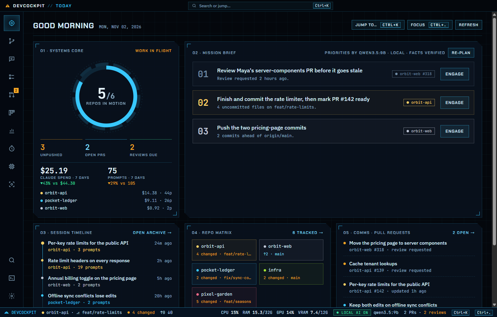
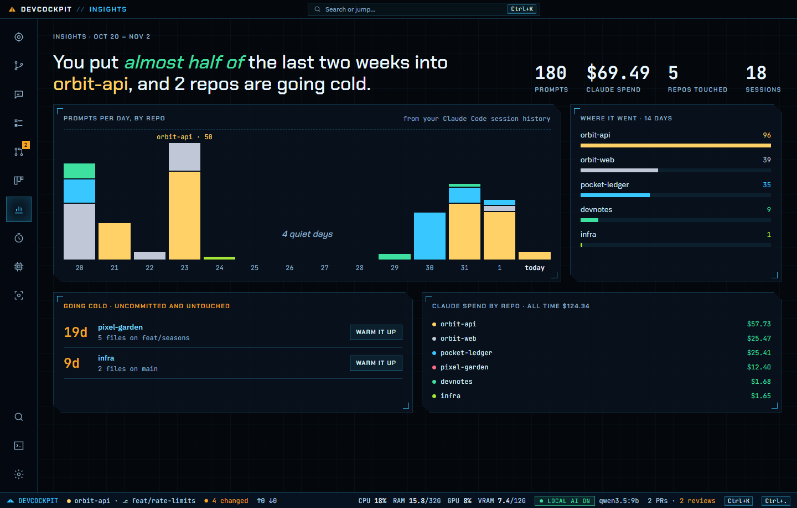
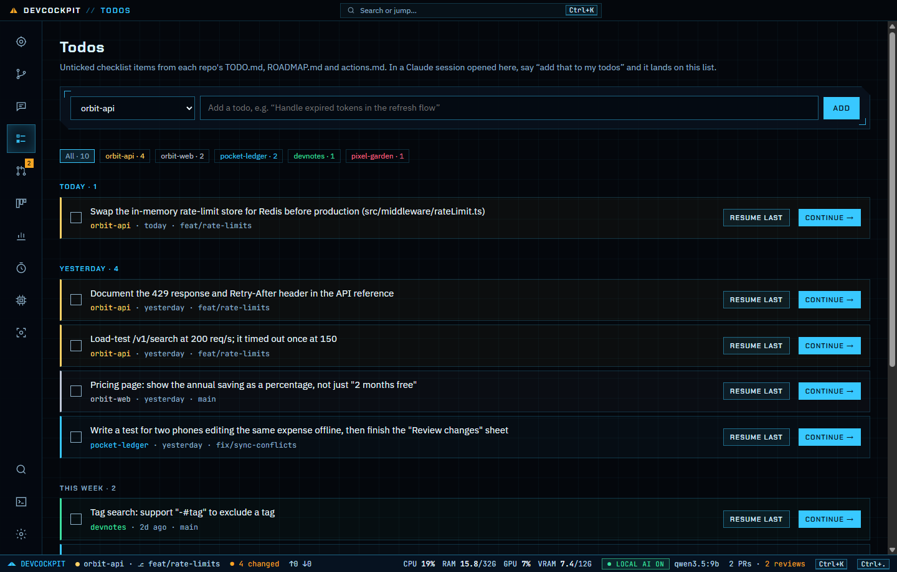
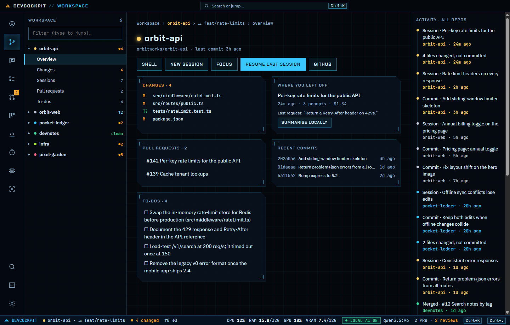
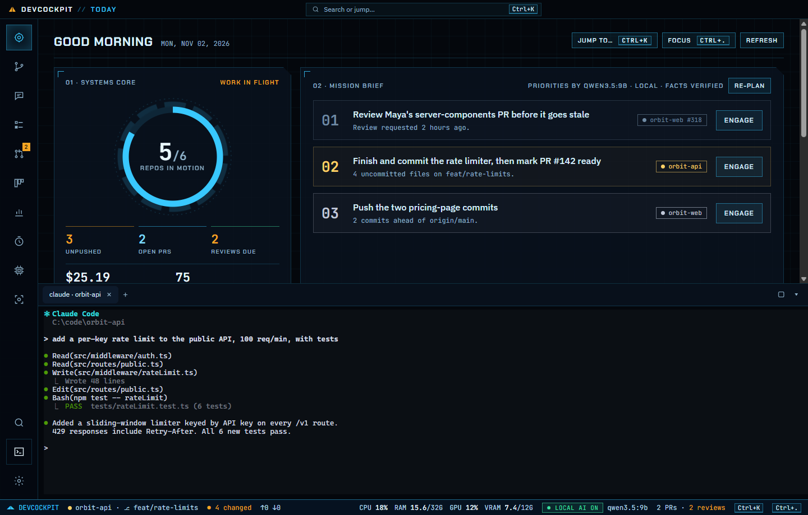

# DevCockpit

[](https://github.com/pananon/devcockpit/actions/workflows/ci.yml) [](https://scorecard.dev/viewer/?uri=github.com/pananon/devcockpit) [](LICENSE)

**The cockpit for your dev day.** One desktop app that shows everything you're working on locally: every repo, every Claude Code session, every open pull request. Resume any session in the built-in terminal with one click.

> Status: early (v0.1). Feedback welcome: open an issue.



<table>
  <tr>
    <td></td>
    <td></td>
  </tr>
  <tr>
    <td></td>
    <td></td>
  </tr>
</table>

<sub>Screenshots use demo mode: every repo, session and number in them is made up.</sub>

## What it does

- **Today (mission control)**: where to start. Three priorities, each linked to the repo, PR or session it comes from, with one click to engage. The facts are taken straight from git, your sessions and GitHub, and the local model only ranks them, so nothing is made up. It works without a model too. Also on the page: a session timeline, a repo matrix, your PRs and your next routine.
- **Workspace**: every git repo in your project folders as one tree. Changes, sessions, pull requests and to-dos (from `TODO.md`, `actions.md` and `ROADMAP.md`) sit under the repo they belong to, next to an activity feed across all repos.
- **Command palette** (`Ctrl+K`): jump to any repo, session or PR, run a repo's actions, or ask the local model a question. Press `g` then a letter to switch screens.
- **Focus mode** (`Ctrl+.`): one repo and one next step, with everything else queued behind it. Press `1`, `2` or `3` to switch.
- **Flow board**: your work as a pipeline: In progress, Ready to push, In review, Shipped. Work that has gone stale is flagged.
- **Insights**: where your last two weeks went. Prompts per day by repo, Claude spend per repo, and repos "going cold" (uncommitted work nobody has touched for a week) with a button to resume where you left off. Today also shows this week's spend and prompts against last week.
- **Status bar**: live CPU, RAM, GPU and VRAM use, so you can see when a local model is loaded.
- **Sessions**: all your Claude Code sessions, grouped by repo and searchable by full text. Read any transcript, **Resume** it in the right folder, or delete old ones (they go to the Recycle Bin, so nothing is lost by accident).
- **Todos**: every open checklist item in your repos' `TODO.md`, newest first. In a Claude session opened from DevCockpit, say "add that to my todos" and Claude writes it there with today's date; **Continue** starts a new session on it. You can turn this off in Settings.
- **Skills library**: when Claude uses a skill in any session (like a website-design or product-video skill), DevCockpit offers to save it. You review every file first, with risky lines flagged. Then install it for every repo (`~/.claude/skills`), or into one repo's `.claude/skills` to share it with your team. You can turn the prompt off in Settings. **Find skills online** lets you describe what you need: Claude Code searches GitHub for matching skills (or use GitHub search with no AI), and DevCockpit checks every result itself, pins it to a commit and ranks the safest first.
- **Pull requests**: yours, the ones waiting for your review, and recently merged ones, across every repo. Uses your existing `gh` login.
- **Built-in terminal**: real Claude Code and shell tabs inside the app (`Ctrl+\``).
- **Routines**: scheduled jobs (daily brief, questions to the local model, read-only Claude Code tasks), with notifications and an optional tray mode so they run with the window closed.
- **Local AI**: one click checks your CPU, RAM and GPU and recommends the best model your machine can run through [Ollama](https://ollama.com). Use it for briefs, session summaries and questions about your work, without spending Claude tokens. It's optional: switch it off from the status bar or Settings and DevCockpit unloads the model (freeing GPU memory) and stops contacting Ollama. The brief then uses simple rules, and Ask and summaries are hidden.

## Install

Download the latest installer from [Releases](https://github.com/pananon/devcockpit/releases):

- **Windows:** `DevCockpit-…-windows-x64-setup.exe`. It isn't code-signed yet, so SmartScreen will warn once: click **More info → Run anyway**.
- **macOS:** `…-mac-arm64.dmg` (Apple Silicon) or `…-mac-x64.dmg` (Intel). It's unsigned, so the first time, right-click the app and choose **Open**.
- **Linux:** the `.AppImage`. Run `chmod +x` on it, then start it.

Every installer is built by this repo's GitHub Actions and carries a signed build attestation. To check that a download came from here, run `gh attestation verify <file> --repo pananon/devcockpit`.

You'll want [Claude Code](https://claude.com/claude-code) installed, and optionally the [GitHub CLI](https://cli.github.com) (logged in) for pull requests and [Ollama](https://ollama.com) for local AI.

## Known limitations

- **Unsigned installers.** There's no Windows or Apple code-signing certificate yet, so the OS warns on first launch. The build attestations above prove where the files came from.
- **Windows is the most tested platform.** The macOS and Linux builds are produced by CI but have had little real-world testing. Please report anything odd.
- **No auto-update.** Download new versions from Releases.
- **Claude Code's session format is undocumented.** DevCockpit reads it carefully and skips anything it doesn't understand, but a Claude Code update could change what it can show.
- **GPU usage in the status bar needs an NVIDIA card** (`nvidia-smi`). CPU and RAM work everywhere.
- **Repos are found up to two folders deep** inside your project folders.

## Roadmap

- **Phase 2 (done):** local AI, a fact-grounded daily brief, and formatted transcripts.
- **Phase 3 (done):** routines. Two features were built and then left out of the main app on purpose: an email assistant, because no mailbox access means no stored credentials, and voice input, which wasn't polished enough to ship. Voice lives on the `feature/voice` branch.
- **Phase 4 (done):** a Windows installer (macOS and Linux builds configured), a hardened package, demo mode, Insights, Todos, a local AI switch, security CI and contributor docs.
- **Next:** signed release builds for all three platforms, then the public launch.

## Security

DevCockpit embeds a real terminal, so security comes first:

- It never opens a network port. The UI talks to the backend over Electron IPC.
- The UI is sandboxed with no Node access, and IPC is limited to a small set of validated calls.
- A strict Content Security Policy blocks remote code.
- Transcripts are never rendered as HTML.
- No browser permissions are granted.
- There's no telemetry and no stored credentials. GitHub access goes through your own `gh` login.
- Skills are reviewed before they're saved or installed, and a skill that seems to contain a key or token can't be installed into a repo.

See [SECURITY.md](SECURITY.md).

## Development

Requires Node 22+, git, and optionally the [GitHub CLI](https://cli.github.com) and [Claude Code](https://claude.com/claude-code).

```bash
npm ci
npm run dev        # run with hot reload
npm run typecheck
npm run build
npm run demo       # run with made-up data
```

Demo mode fills every screen with fictional repos, sessions and PRs, so screenshots and screen recordings never show your real work. It reads nothing from your disk, runs no commands, and keeps its own settings. The terminal replays a sample session and doesn't run anything you type. The installed app takes the same `--demo` flag.

## Contributing

Issues and pull requests are welcome. Start with [CONTRIBUTING.md](CONTRIBUTING.md): it covers the code layout and the security rules every change follows. Please report vulnerabilities privately (see [SECURITY.md](SECURITY.md)).

## License

[MIT](LICENSE). DevCockpit is an independent project and is not affiliated with or endorsed by Anthropic.
